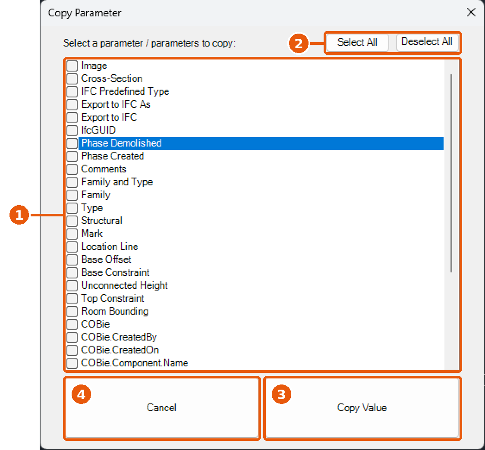
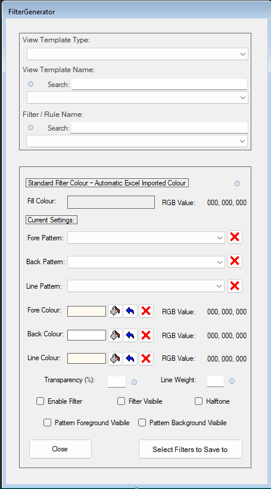
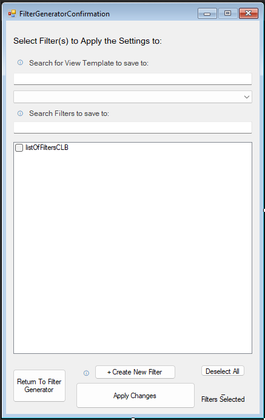
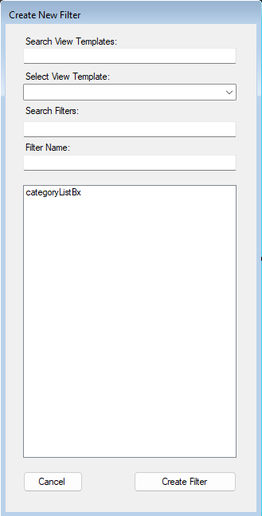

# Work Experience at an Engineering Consultancy:

Work experience completed for my [T-Level in Digital Software Development](https://qualifications.pearson.com/en/qualifications/t-levels/digital-software-development.html) (2025-2027), building add-ins for Autodesk Revit in **C#**.
 

| | |
|---|---|
| **Placement** | Engineering consultancy (building services: mechanical and electrical) |
| **Software** | [Autodesk Revit](https://www.autodesk.com/uk/products/revit/overview) |
| **Language** | C# |
| **Attendance** | One day a week, November 2025 – 10th November 2026 ([30 days in total](#dates)) |

> **Note:** I cannot show my code for these add-ins due to a Non-Disclosure Agreement I signed, however I am allowed to show off pictures of each piece of work I did and explain what they do (I was told I was allowed to do this by the person who owns the codebase for these add-ins).

## Contents
 
1. [About the company and my role](about-the-company-and-my-role)
2. [Copy Parameters](#1-copy-parameters)
3. [Filter Manager](#2-filter-manager)
4. [Converting Winforms to WPFs](#3-wpf)
5. [Dates attended](#dates)

---

<h2 id="about-the-company-and-my-role">About the company and my role:</h2>

During my work placement for my course I worked at an engineering consultancy that designs the mechanical and electrical systems inside buildings, such as heating, ventilation, air conditioning, lighting and power, and water services. The company works with architects, contractors and clients to plan these systems at the design stage of construction projects. 

The people working there utilised a piece of software called [Revit](https://www.autodesk.com/uk/products/revit/overview) (by AutoDesk).

My job was to create something called "[add-ins](https://revizto.com/resources/blog/revit-addins-addons-plugins)" for Revit, to help the engineers work faster by automating repetitive tasks within an already existing codebase (one of the engineers made add-ins already and I was working with him during my time).

Essentially, an add-in can turn a longer task (requiring multiple clicks / edits) into a much shorter one (making it a couple clicks / more efficient).

---

<h2 id="1-copy-parameters">Copy Parameters:</h2>

Since I was just getting into Revit, I started by developing A "Copy Parameters" add-in for Revit. 

<h3>Explanation of what Parameters are:</h3>

Each object in Revit (whether a duct, a light fixture, a pipe, or a room) will have parameters, which are named fields of information. Some of these are part of the software itself, such as Length, Level or System Type. Other data fields include those created by the company, such as Asset Code, Zone, Maintenance Category or Fire Rating. Engineers fill these in so they can appear in schedules, tags and drawings, and be handed over to clients.

Doing this one by one will take a lot of time, so a Copy Parameters add-in would allow for more time efficiency in the office.

<h3>What I learned:</h3>

Working in someone else's codebase was overwhelming at first, especially one built for engineering software I had never used.

However, I did eventually persevere after exploring through the pre-existing code, as well as Revit's API and forums related to Revit.

  
   
  <em>My first Revit add-in, Copy Parameters (click to enlarge)</em>

1. **Parameter list**: every parameter on the selected element, each with a tick box to choose which ones to copy.
2. **Select All / Deselect All**: ticks or clears every parameter at once.
3. **Copy Value**: copies the values of the ticked parameters onto the target element(s).
4. **Cancel**: closes the window without changing anything.

_[back to top](#top)_

---

<h2 id="2-filter-manager">Filter Manager:</h2>

After I finished my work on "Copy Parameters", I was assigned to created a "Filter Manager".

<h3>Explanation of what a Filter is in Revit:</h3>

A filter solves visual clutter in a bust drawing, this is done by picking out objects that match a set of rules and changing how they look in a view.

Each filter is made of two parts:

- **Rules**: which objects the filter applies to. These are based on categories and parameters, for example "all Ducts where System Type equals Supply Air".
- **Graphic overrides**: what happens to the matching objects in the view. They can be given a different colour, line style or transparency, or be hidden completely.

For example, an engineer could make supply air ducts show in blue and extract air ducts in red, so the two systems can be told apart at a glance on a drawing.

Filters are applied per view, so the same model can look different depending on who the drawing is for. Because the rules are based on parameters, the filters update automatically as the model changes: any new duct set to "Supply Air" will turn blue without anyone needing to colour it by hand.

<h3>Explanation of what the "Filter Manager" would consist of:</h3>

The Filter Manager is an add-in which enabled engineers to set up and edit the filters inside Revit's View Templates from a single window, not having to go through the Revit menus filter by filter.

A **View Template** is a saved set of display settings that can be applied to many views simultaneously, so every drawing of the same type looks consistent. Filters are stored in View Templates, thus editing filter display properties requires opening every template and editing filters manually.

The Filter Manager works in these steps:

1. **Choosing a template**: The user chooses the View Template Type and subsequently a particular template to be edited.
2. **Choosing a filter**: The user chooses the filter they want to edit form the list of filters that are present in the template.
3. **Match it to the company colour list**: The add-in finds the name of the chosen filter in an Excel file that contains the list of filter names used across the company, along with their corresponding RGB colour values. The relevant colour is displayed in a coloured box, allowing the user to immediately see which colour should be assigned to the filter.
4. **View and edit the filter's settings**: The add-in retrieves the current filter settings from Revit and allows the user to adjust them, including:
   - Foreground pattern and colour
   - Background pattern and colour
   - Line pattern, colour, and weight
   - Transparency
   - Status (enabled/visible) as well as the display of foreground and background patterns
5. **Apply to multiple filters**: The user can select several filters simultaneously and apply settings to all of them in a single step.

By combining information from Revit with data from an Excel file, the "Filter Manager" ensures that filter colours consistently adhere to company standards. Furthermore, it streamlines a time-consuming, repetitive process, reducing it to just a few mouse clicks.

<h3>What I learned / did:</h3>

> **Note / Disclaimer:** I utilised AI to help create this add-in, being in once a week caused a bit of a struggle to learn Revit's API, and the only way I'd get this done in a reasonable timeframe (that'd keep me sane) in my personal opinion was to utilise AI, specifically ChatGPT.

<table>
  <tr>
    <td align="center">
      
       <em>Main window</em>
    </td>
    <td align="center">
      
       <em>Select Filters to Save to</em>
    </td>
    <td align="center">
      
       <em>Create Filter</em>
    </td>
  </tr>
</table>
<em>Click any image to enlarge</em>

I built the Filter Manager as a Windows Forms (WinForm) window, it ended up being made of three WinForm windows:

1. **The Main Filter Manager window** (pictured on the left above), where the user picks a View Template and a filter, then views and edits its settings.
2. **A "Select Filters to Save to" window** (pictured on the middle above), where the user ticks every filter they want the settings saved to. They can also switch to a different View Template, and the window warns them before switching if it would lose their ticked filters.
3. **A "Create Filter" window** (pictured on the right above), which lets the user copy an existing filter under a new name.

Some of the main parts I worked on:

- **Reading from Revit**: collecting every View Template in the model, sorting them by type (floor plans, sections, 3D views, etc.), and loading the filters attached to whichever template is chosen. The window also auto-selects the template of the view the user is currently on, to save them a step.

- **Search boxes**: with hundreds of templates and filters in a model, scrolling through a dropdown is slow, so I added search boxes that narrow the lists as the user types.

- **Reading from Excel**: the add-in opens the company's Excel file of filter names and RGB colours, finds the matching filter and shows its colour in a box. The colour values in the spreadsheet weren't always written the same way (some used commas, others dashes or spaces), so I made it handle all of them. If the Excel file can't be found, the add-in asks the user to locate it and remembers where it is for next time.

- **Editing the settings**: each colour has three buttons: pick a new colour, revert to the original, or clear it (no override). Each pattern dropdown has a "No Override" option, and there are boxes for transparency, line weight, halftone and visibility.

- **Saving back to Revit**: every change made to the model has to happen inside a Revit "transaction", so the changes are applied together and can be undone in one step.
- **Tooltips**: the ⓘ icons explain what each setting does, for engineers who don't use filters often.

_[back to top](#top)_

---

<<<<<<< HEAD

<h2 id="3-wpf">Converting Window's Forms into WPFs <small>(Windows Presentation Foundations)</small></h2>

=======

<h2 id="3-wpf">Converting Window's Forms into WPFs (Windows Presentation Foundations)</h2>

>>>>>>> 2db776b075fbe8a5230a901971e7dccaab56a008

<h3>Explanation of what WinForms and WPF are:</h3>

Windows Forms (**WinForms**) and Windows Presentation Foundation (**WPF**) are both Microsoft frameworks for building windows (the boxes, buttons, lists and text fields a user clicks on) for programs that run on Windows. Revit add-ins can use either one to show their windows.

**WinForms** is the older of the two, released in 2002. Each window is built by dragging controls onto a design surface in Visual Studio, and every control is placed at a fixed position and size in pixels. It's quick and simple to use, but windows can look dated, don't resize well, and can appear blurry or squashed on high-resolution screens.

**WPF** is the newer framework, released in 2006. Instead of fixed positions, the layout of a window is written in **XAML** (a markup language similar to HTML), which describes how controls are arranged relative to each other. The window can then stretch and scale cleanly to any size or screen. The look of the window is kept separate from the C# code that makes it work, and styles (colours, fonts, button designs) can be written once and shared across every window, a bit like CSS on a website.

For example, a simple WPF button looks like this in XAML:

    <Button Content="Finish" Width="120" Style="{StaticResource PrimaryButtonStyle}" />

| | WinForms | WPF |
|---|---|---|
| **Released** | 2002 | 2006 |
| **How the layout is made** | Controls placed at fixed pixel positions | Written in XAML, with controls arranged relative to each other |
| **Resizing and high-resolution screens** | Can look blurry or misaligned | Scales cleanly |
| **Styling** | Set on each control one at a time | Shared styles reused across every window |
| **Look** | Classic, older Windows style | Can be fully customised to look modern |
| **Learning curve** | Easier to pick up | Harder at first, but more flexible |

The add-ins in the codebase were originally built with WinForms. They were being converted to WPF so that every window shares the same modern design and works properly on any screen size.

---

<h3 id="dates">Exact Dates:</h3>

| Month | Tuesdays attended |
|---|---|
| November 2025 | 25th |
| December 2025 | 2nd, 9th, 16th |
| January 2026 | 6th, 13th, 27th |
| February 2026 | 3rd, 10th, 24th |
| March 2026 | 3rd, 10th, 17th, 24th, 31st |
| April 2026 | 21st, 28th |
| May 2026 | 5th |
| June 2026 | 16th, 23rd, 30th |
| September 2026 | 8th, 15th, 22nd, 29th |
| October 2026 | 6th, 13th, 20th |
| November 2026 | 3rd, 10th |

_[back to top](#top)_

---
