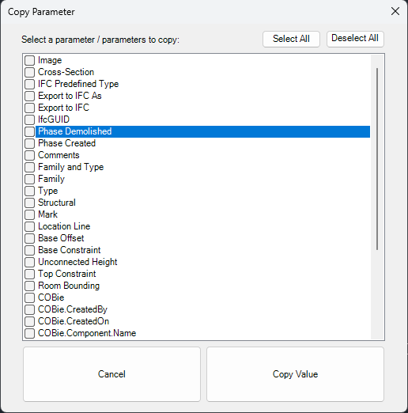

# Description of my Work Experience for an Engineering Consultancy:
### This was Work Experience I did for my [T-Level Course](https://qualifications.pearson.com/en/qualifications/t-levels/digital-software-development.html), I used C# as the coding language.
#### I attended one day a week from November 2025 - 10th of November 2026, 30 days in total. ([full list of dates](#dates))

#### Description of the company and my job:

During my work placement for my course I worked at an engineering consultancy that designs the mechanical and electrical systems inside buildings, such as heating, ventilation, air conditioning, lighting and power, and water services. The company works with architects, contractors and clients to plan these systems at the design stage of construction projects. 

The people working there utilised a piece of software called [Revit](https://www.autodesk.com/uk/products/revit/overview) (by AutoDesk).

My job was to create something called "[add-ins](https://revizto.com/resources/blog/revit-addins-addons-plugins)" for Revit, to help the engineers work faster by automating repetitive tasks within an already existing codebase (one of the engineers made add-ins already and I was working with him during my time).

Essentially, an add-in can turn a longer task (requiring multiple clicks / edits) into a much shorter one (making it a couple clicks / more efficient).

| # | Entry |
|:-:|-------|
| 1 | [Initial Work](#start) |
| 2 |  |

Note: I cannot show my code for these add-ins due to a Non-Disclosure Agreement I signed, however I am allowed to show off pictures of each piece of work I did and explain what they do (I was told I was allowed to do this by the person who owns the codebase for these add-ins).

<h2 id="start">Initial Work:</h2>

Since I was just getting into Revit, I started by developing A "Copy Parameters" add-in for Revit. 

Explanation of what Parameters are:
> Each object in Revit (whether a duct, a light fixture, a pipe, or a room) will have parameters, which are named fields of information. Some of these are part of the software itself, such as Length, Level or System Type. Other data fields include those created by the company, such as Asset Code, Zone, Maintenance Category or Fire Rating. Engineers fill these in so they can appear in schedules, tags and drawings, and be handed over to clients.
> Doing this one by one will take a lot of time, so a Copy Parameters add-in would allow for more time efficiency in the office.

Entering someone's codebase is quite overwhelming I discovered, especially when you aren't an engineer who has to create ontop of this codebase for an engineering app. However, I did persevere after exploring through the pre-existing code, as well as Revit's API and forums related to Revit.

  
   
  <em>My first Revit add-in, Copy Parameters (click to enlarge)</em>

<h3 id="dates">Exact Dates:</h3>

- Tuesday 25th November 2025
- Tuesday 2nd December 2025
- Tuesday 9th December 2025
- Tuesday 16th December 2025
- Tuesday 6th January 2026
- Tuesday 13th January 2026
- Tuesday 27th January 2026
- Tuesday 3rd February 2026
- Tuesday 10th February 2026
- Tuesday 24th February 2026
- Tuesday 3rd March 2026
- Tuesday 10th March 2026
- Tuesday 17th March 2026
- Tuesday 24th March 2026
- Tuesday 31st March 2026
- Tuesday 21st April 2026
- Tuesday 28th April 2026
- Tuesday 5th May 2026
- Tuesday 16th June 2026
- Tuesday 23rd June 2026
- Tuesday 30th June 2026
- Tuesday 8th September 2026
- Tuesday 15th September 2026
- Tuesday 22nd September 2026
- Tuesday 29th September 2026
- Tuesday 6th October 2026
- Tuesday 13th October 2026
- Tuesday 20th October 2026
- Tuesday 3rd November 2026
- Tuesday 10th November 2026

